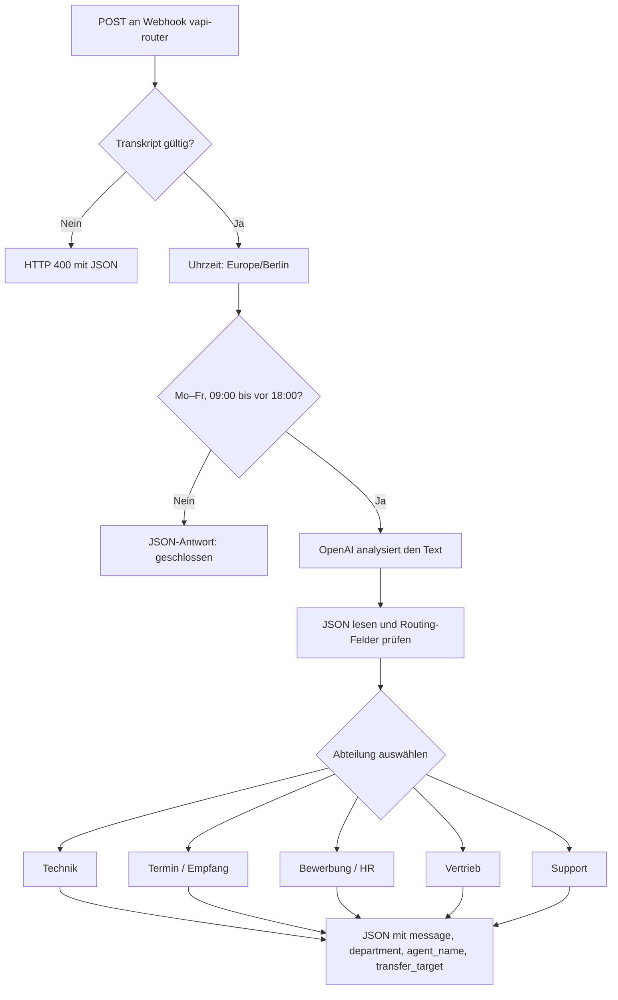

# AI Voice Routing & Customer Support

KI-gestützter n8n-Prototyp zur Zuordnung von Kundenanfragen. Ein Webhook nimmt einen transkribierten Text entgegen. Der Workflow prüft die Berliner Geschäftszeiten, klassifiziert das Anliegen mit OpenAI und antwortet mit der zuständigen Abteilung und einem logischen Weiterleitungsziel.

[](https://github.com/Mc-smail/ai-voice-routing/actions/workflows/tests.yml)

## Ablauf



## Funktionen

| Bereich | Verhalten im Workflow |
| --- | --- |
| Eingang | POST-Webhook mit nicht leerem `transcript` im JSON-Body, maximal 8000 UTF-16-Codeeinheiten |
| Geschäftszeiten | Montag bis Freitag, 09:00 bis vor 18:00 Uhr; Zeitzone Europe/Berlin mit Sommerzeit |
| KI-Analyse | OpenAI-Knoten, im Export mit `gpt-4o-mini` konfiguriert |
| Routing | Technik, Termin, Bewerbung, Vertrieb oder Support |
| Entscheidungslogik | Eindeutige Schlüsselwörter haben Vorrang vor der KI-Kategorie; Reihenfolge: Termin, Technik, Bewerbung, Vertrieb |
| JSON-Verarbeitung | Liest Modellantworten, Codeblöcke und JSON mit Vorrede und gibt geprüfte Routing-Felder weiter |
| Standardwerte | Unbekannte Kategorien fallen auf Support zurück. Unbekannte Priorität wird zu `mittel`. Das Anliegen umfasst bis zu 500 Unicode-Codepunkte. Die interne Aktion ist `weiterleiten`. |
| Ergebnis | Strukturierte Webhook-Antwort mit Abteilung, Team und logischem Ziel |

Bewerbungsbegriffe werden an Unicode-Wortgrenzen erkannt. So bleibt „Ihre Rechnung“ beim Support, während „HR-Abteilung“ zur Bewerbung gehört; „bestellen“ wird dem Vertrieb zugeordnet. Die Reihenfolge der Routing-Zweige bleibt bestehen.

Der Export enthält **21 Knoten**. Die Antworten liefern Ziele wie `technik_agent`. Ein externer Telefoniedienst muss diese Ziele auf echte Agenten oder Telefonnummern abbilden. Ein tatsächlicher Telefontransfer, CRM-Anbindung und produktiver Telefoniebetrieb sind Erweiterungen. Vapi, Deepgram, ElevenLabs und Twilio werden als mögliche Integrationskomponenten betrachtet; ihre Kontokonfigurationen sind nicht Bestandteil dieses Repositories.

## In n8n starten

1. Importiere [`workflows/ai-voice-routing.json`](workflows/ai-voice-routing.json) über **Import from File** in deine n8n-Instanz.
2. Öffne **Message a model** und wähle dein eigenes OpenAI-Credential. Prüfe, ob dein API-Konto Zugriff auf das ausgewählte Modell hat.
3. Öffne **Webhook** und starte den Testmodus. Verwende die dort angezeigte Test-URL.
4. Sende eine JSON-Anfrage. Außerhalb der Geschäftszeiten antwortet der Workflow mit dem Hinweis auf die Öffnungszeiten.
5. Für den dauerhaften Eingang den Workflow veröffentlichen und die angezeigte Production-URL verwenden.

Setze die in n8n angezeigte Test-URL ein und sende die Anfrage, während der Webhook im Testmodus wartet.

```bash
curl --request POST 'TEST_URL_AUS_N8N' \
  --header 'Content-Type: application/json' \
  --data '{"transcript":"Mein Router funktioniert nicht."}'
```

Beispielantwort während der Geschäftszeiten bei Zuordnung zur Technik:

```json
{
  "message": "Ich verbinde Sie jetzt mit dem Technik Team.",
  "department": "technik",
  "agent_name": "Technik Team",
  "transfer_target": "technik_agent"
}
```

Eine ungültige Eingabe erhält **HTTP 400** mit `status: invalid_request` und einem Hinweis zum Feld `transcript`. Die Prüfung läuft vor der Geschäftszeitprüfung und dem Modellaufruf.

### Geschäftszeiten gezielt testen

`npm test` prüft beide Zweige mit festen Berliner Uhrzeiten. Im n8n-Testmodus entscheidet die aktuelle Berliner Uhrzeit. Die Anfrage übergibt den Text unter `transcript`. Außerhalb der Öffnungszeiten antwortet der Workflow ohne OpenAI-Aufruf. Für einen extern erreichbaren Betrieb richte die Webhook-Authentifizierung in n8n ein.

## Tests

Voraussetzung: Node.js ab Version 22. Es werden keine npm-Pakete und keine API-Schlüssel benötigt.

```bash
npm test
```

Die Tests prüfen die exportierten Code-Knoten mit synthetischen Daten: Verbindungen, Geschäftszeitgrenzen, Sommer-/Winterzeit, JSON-Verarbeitung, Kategorien und Abteilungsantworten. GitHub Actions führt dieselben Tests auf Node.js 22 und 24 aus. Ein echter OpenAI-Aufruf, ein laufender n8n-Server oder ein Telefonanruf wird dabei nicht simuliert oder als bestanden behauptet.

## Dateien und Daten

| Datei | Inhalt |
| --- | --- |
| [`workflows/ai-voice-routing.json`](workflows/ai-voice-routing.json) | Bereinigter, importierbarer n8n-Workflow |
| [`workflow.test.mjs`](workflow.test.mjs) | Automatisierte Tests der exportierten Logik |
| [`.github/workflows/tests.yml`](.github/workflows/tests.yml) | Automatische GitHub-Prüfung |

Die Veröffentlichung basiert auf dem bestehenden n8n-Workflow. Die öffentliche Kopie korrigiert den JSON-Ausdruck für Antworten mit Vorrede und berechnet die Berliner Uhrzeit unabhängig von der Zeitzone des Servers. Der ursprüngliche lokale Workflow bleibt unverändert.

Zugangsdaten, gespeicherte Ausführungen, konkrete Telefonnummern und persönliche Tunnel-Adressen sind nicht enthalten. Die ursprüngliche PDF-Dokumentation enthält solche Konfigurationsangaben und wird deshalb durch diese öffentliche README beschrieben. Eigene Kundenanfragen werden bei Nutzung des KI-Zweigs an OpenAI übertragen.

**Autor:** Smail Ennaji Edrissi
